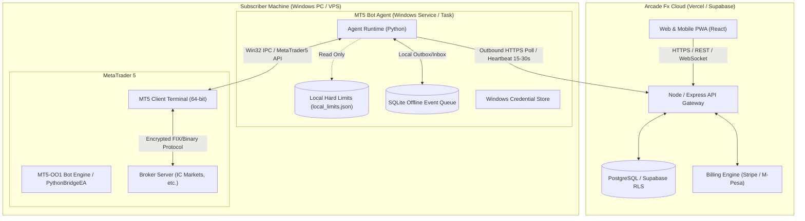
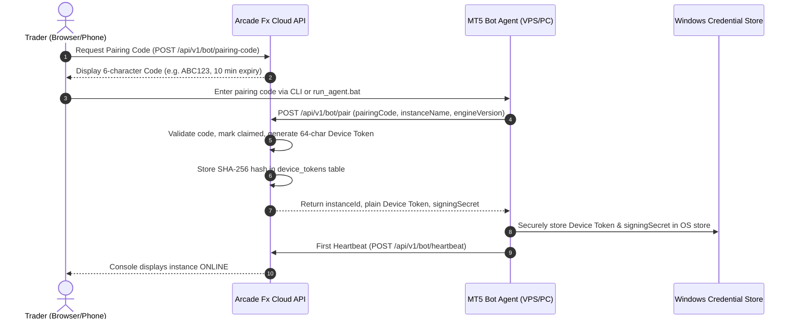
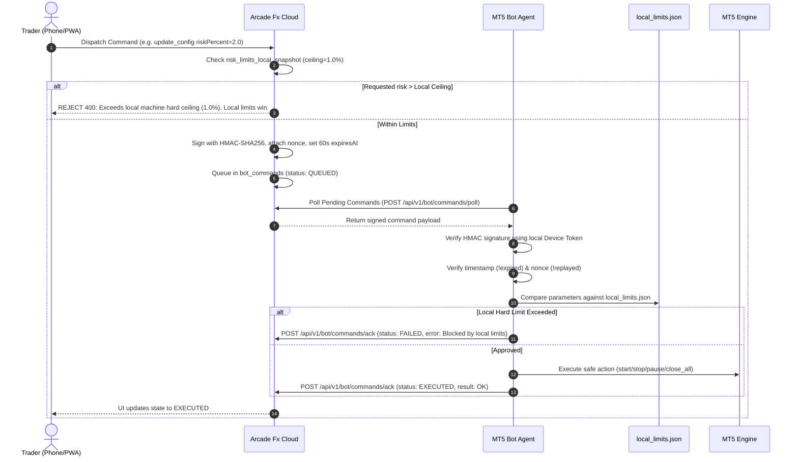
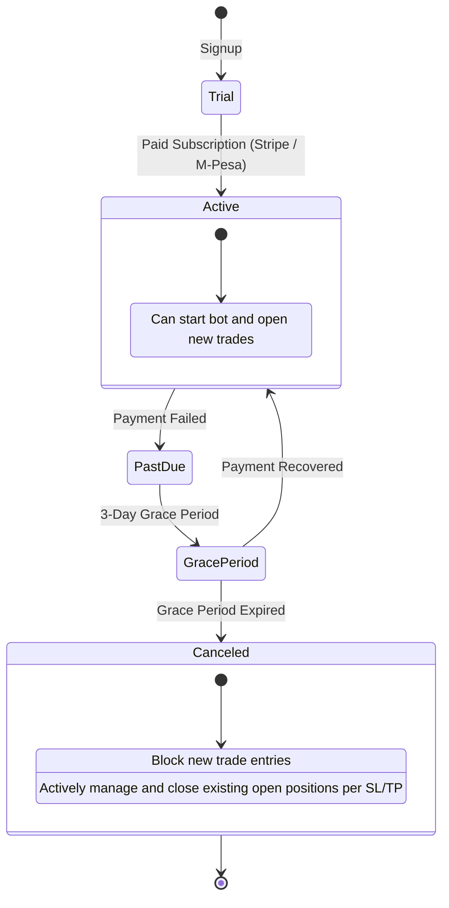

# Arcade Fx Architecture: MT5 Bot Management System

This document outlines the distributed architecture, security model, and communication protocols connecting the **Arcade Fx Cloud Management Console** (`arcadefx.live`) with subscriber **MT5 Bot Agents** running on client Windows PCs or VPS instances.

---

## 1. High-Level System Topology

> [!IMPORTANT]
> **Outbound-Only Connectivity**: The agent initiates all communication. No inbound ports (TCP/UDP) are ever opened on the subscriber's machine or VPS. The cloud cannot initiate raw socket connections into the user's network.

---

## 2. Secure Pairing Protocol

---

## 3. Cloud Command Verification & Local Risk Ceiling Supremacy

Every cloud command undergoes dual-layer validation:

1. **Cloud Server Validation:** Ensures user has an active entitlement, checks reported local risk ceiling snapshot, and signs the command.
2. **Local Agent Validation:** The agent verifies the HMAC signature, checks nonce replay protection and expiration, and compares requested values against `local_limits.json`.

---

## 4. Offline Resilience & Queueing

If internet connectivity to the Arcade Fx cloud drops:
- **Autonomous Local Protection:** The bot continues running strictly within `local_limits.json` rules. The broker continues enforcing hard stop-losses and take-profits on the broker's servers.
- **SQLite Outbox:** Telemetry events and deal records are stored in a local SQLite file (`agent_events.db`).
- **Idempotent Sync:** When internet connectivity resumes, queued events are flushed in chronological order with unique event IDs, preventing duplicate telemetry on the server.

---

## 5. Entitlement & Subscription Lifecycle

